<!-- ============================================================
  GANTI "USERNAME" dengan username GitHub kamu (cari & ganti semua).
  Ganti juga link kontak di bagian paling bawah.
============================================================= -->

<picture>
  <source media="(prefers-color-scheme: dark)" srcset="./assets/banner-dark.svg">
  
</picture>

<picture>
  <source media="(prefers-color-scheme: dark)" srcset="https://readme-typing-svg.demolab.com?font=JetBrains+Mono&weight=600&size=20&duration=3200&pause=1200&color=89B4FA&center=true&vCenter=true&width=620&height=40&lines=Halo%2C+aku+Javier+%F0%9F%91%8B;Full-stack+dev+yang+ngoding+bareng+AI+%F0%9F%A4%96;Bikin+web+%26+app+yang+rapi%2C+fun%2C+dan+berguna+%E2%9C%A8;Let's+build+something+cool+together+%F0%9F%9A%80">
  
</picture>

## 👾About me

- 🛠️ **Full-stack developer** yang suka membangun produk bareng AI sebagai co-pilot
- 🔭 Currently building: **[Clouven.two-V2](https://github.com/Pierr15/Clouven.two-V2)**
- 🌱 Currently learning: _Supabase, Docker, AWS_ <!-- ganti sesuai yang kamu pelajari -->
- 🎮 Ngoding paling enak sambil main game dan dengerin musik
- 💬 Ngobrol soal web, AI, atau ide proyek? **Chat aja!**

## Tech Stack

  <picture>
    <source media="(prefers-color-scheme: dark)" srcset="https://skillicons.dev/icons?i=html,css,js,ts,react,nodejs,firebase,git&theme=dark&perline=8">
    
  </picture>

<!-- Mau tambah ikon? Edit daftar "i=..." — lihat nama ikon di https://skillicons.dev -->

## Github Stats

  <picture>
    <source media="(prefers-color-scheme: dark)" srcset="https://github-readme-stats.vercel.app/api?username=Pierr15&show_icons=true&hide_border=true&border_radius=12&bg_color=1e1e2e&title_color=89b4fa&text_color=cdd6f4&icon_color=cba6f7&ring_color=89b4fa&count_private=true&include_all_commits=true">
    
  </picture>
  <picture>
    <source media="(prefers-color-scheme: dark)" srcset="https://github-readme-stats.vercel.app/api/top-langs/?username=Pierr15&layout=compact&langs_count=8&hide_border=true&border_radius=12&bg_color=1e1e2e&title_color=89b4fa&text_color=cdd6f4">
    
  </picture>

  <picture>
    <source media="(prefers-color-scheme: dark)" srcset="https://streak-stats.demolab.com?user=Pierr15&hide_border=true&border_radius=12&background=1E1E2E&stroke=313244&ring=89B4FA&fire=CBA6F7&currStreakNum=CDD6F4&sideNums=CDD6F4&currStreakLabel=89B4FA&sideLabels=A6ADC8&dates=A6ADC8">
    
  </picture>

## 🚀 Proyek Unggulan

  <a href="https://github.com/Pierr15/Clouven.two-V2">
    <picture>
      <source media="(prefers-color-scheme: dark)" srcset="https://github-readme-stats.vercel.app/api/pin/?username=Pierr15&repo=Clouven.two-V2&hide_border=true&border_radius=12&bg_color=1e1e2e&title_color=89b4fa&text_color=cdd6f4&icon_color=cba6f7">
      
    </picture>
  </a>

## 🐍 Kontribusi

  <picture>
    <source media="(prefers-color-scheme: dark)" srcset="https://raw.githubusercontent.com/Pierr15/Pierr15/output/github-snake-dark.svg">
    
  </picture>

## 🎧 Game & Musik

<!-- Edit sesuka kamu: isi dengan game dan musik favoritmu -->

| 🎮 Game favorit                                              | 🎵 Lagi sering diputar |
| :----------------------------------------------------------- | :--------------------- |
| _Blue Archive, Honkai: Star Rail, Mobile Legends: bang Bang_ | _Shine in The Sky_     |

## 📫 Mari Terhubung

  
  
  
  
  

Dibuat dengan 💙 dan palet <a href="https://catppuccin.com">Catppuccin</a>

